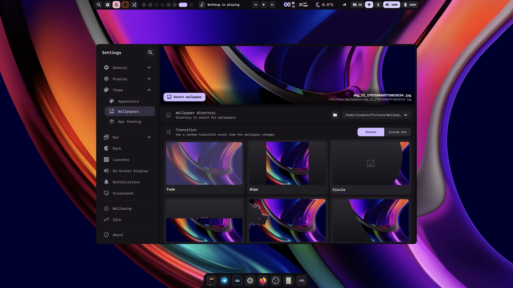

<div align="center">

<pre align="center">
███████╗███████╗██╗     ██╗ ██████╗ ███╗   ██╗
██╔════╝██╔════╝██║     ██║██╔═══██╗████╗  ██║
███████╗█████╗  ██║     ██║██║   ██║██╔██╗ ██║
╚════██║██╔══╝  ██║     ██║██║   ██║██║╚██╗██║
███████║███████╗███████╗██║╚██████╔╝██║ ╚████║
╚══════╝╚══════╝╚══════╝╚═╝ ╚═════╝ ╚═╝  ╚═══╝
</pre>

### Selion Shell

A modern, highly customizable and fluid desktop shell for Wayland.

A fork of [Serpantinum](https://github.com/ilyamiro/serpantinum).  
A big thank you to [@ilyamiro](https://github.com/ilyamiro) for gifting us this creation.

[Telegram](https://t.me/Nathant16) • [Releases](https://github.com/Nathant16/Selion-dots/releases) • [License](LICENSE.md)

</div>

---

## Previews

| | |
|---|---|
|  |  |
|  |  |

---

## Installation

Run the automated installer on any supported distribution (Arch Linux, Fedora, Void Linux, Gentoo, and their derivatives — using `pacman`, `dnf`, `xbps`, or `emerge`):

```bash
bash -c "$(curl -fsSL https://raw.githubusercontent.com/Nathant16/Selion-dots/master/install/install.sh)"
```

> [!NOTE]
> To update, run the command above and choose "6. Update", or click the Update button inside the Settings -> About tab. Your custom configurations, keybindings, and preferences will be preserved.

### Supported compositors

Hyprland, DriftWM, Niri, Sway, Mango and Umbriel. The installer detects the running compositor and deploys its configuration. On Arch, Umbriel is installed from the AUR. On Fedora, Mango and Umbriel are installed from the Terra repository. On Void Linux, Hyprland is installed from the third-party black-hole.dev repository and Umbriel from the third-party UniversalRepository.

---

## Features

- Supported Compositors: Full integration with [DriftWM](compositors/driftwm/README.md), [Hyprland](compositors/hyprland/README.md), [Sway](compositors/sway/README.md), [Niri](compositors/niri/README.md), [Mango](compositors/mango/README.md), and [Umbriel](docs/configure/compositors/umbriel.md).
- Dynamic Theming: Powered by Material You (matugen) - automatically derives accent colors from your wallpaper or lets you choose manual presets, dynamically theming GTK, Qt, Kitty, Fish, and Fastfetch.
- Terminal and Shell Out-of-the-Box:
  - Fish Shell with a custom two-line prompt, theme synchronization on the fly, and handy aliases (eza, bat, zoxide).
  - Fastfetch with a 7-step vertical color gradient matching the active theme palette.
  - Kitty terminal preconfigured with JetBrainsMono Nerd Font and Fish.
  - Starship prompt support (starship.toml).
- Complete Desktop Suite:
  - Modular Top Bar with system monitors, workspaces, media player, and weather cards.
  - Smart Dock with app pinning, running indicators, and context menus.
  - Fullscreen and windowed App Launcher with instant fuzzy search.
  - Control Center and Quick Actions for volume, brightness, Bluetooth, Wi-Fi, night light, and power profiles.
  - Lockscreen with modern clock styles, PAM fprintd fingerprint support, and media controls.
- Laptop and Power Management:
  - Battery charge threshold support (Conservation mode: 80% or custom limit).
  - Power profiles (Power Saver, Balanced, Performance) with automated CPU frequency controls and boost management.
- Curated Wallpapers: Includes a built-in collection of 130+ UHD/QHD wallpapers with recursive indexing and live preview.

---

## Keybindings

Selion uses a unified set of keybindings across all supported window managers. For full tables and architectural comparison, see the [Compositors & Keybindings Guide](compositors/README.md).

Dedicated compositor guides:
- [DriftWM Guide & Keybindings](compositors/driftwm/README.md) — Infinite 2D canvas, bookmarks, window freezing, and zoom
- [Hyprland Guide & Keybindings](compositors/hyprland/README.md) — Dynamic tiling, fluid animations, and 3-finger workspace swipe
- [Sway Guide & Keybindings](compositors/sway/README.md) — Classic i3 manual tiling, scratchpad, and gestures
- [Niri Guide & Keybindings](compositors/niri/README.md) — Scrollable horizontal column ribbon and overview mode
- [Mango Guide & Keybindings](compositors/mango/README.md) — Lightweight dwm-inspired dynamic tiling
- [Umbriel Guide & Keybindings](docs/configure/compositors/umbriel.md) — Lightweight wlroots-based compositor with TOML configuration

### Common Shortcuts

| Keybinding | Action |
|---|---|
| <kbd>Super</kbd> | Toggle App Launcher |
| <kbd>Super</kbd> + <kbd>Return</kbd> | Open Kitty Terminal |
| <kbd>Super</kbd> + <kbd>I</kbd> | Open Settings / Guide |
| <kbd>Super</kbd> + <kbd>E</kbd> | Open File Manager |
| <kbd>Super</kbd> + <kbd>Shift</kbd> + <kbd>S</kbd> | Screenshot tool (Satty / Grim) |
| <kbd>Super</kbd> + <kbd>L</kbd> | Lock Screen |
| <kbd>Super</kbd> + <kbd>Q</kbd> | Close focused window |

---

## Service Management

To start, restart, or stop the shell daemon manually:

```bash
# Start shell daemon
serpantinumd start

# Restart shell
serpantinumd restart

# Stop shell
serpantinumd stop
```

<br><br><br>

<div align="center">
  <h3>Thanks to all contributors</h3>
  <br>

  <a href="https://github.com/TheRinder2"></a>
  <a href="https://github.com/bizneskind-droid"></a>
  <a href="https://github.com/Pigeon78"></a>
  <a href="https://github.com/Eduarduar"></a>
  <a href="https://github.com/Spinty-dev"></a>
  <a href="https://github.com/MrDexstor"></a>
  <a href="https://github.com/coloramamoe"></a>
  <a href="https://github.com/Zyxilon"></a>
  <a href="https://github.com/gouthamkrishnap"></a>
  <a href="https://github.com/Stoltembergg"></a>
  <a href="https://github.com/andckadir"></a>
  <a href="https://github.com/ArseniiTkachuk"></a>
  <a href="https://github.com/MCUxDaredevil"></a>
  <a href="https://github.com/MILKv2"></a>
  <a href="https://github.com/pedrolourencosilva"></a>
  <a href="https://github.com/Vaspyyy"></a>
  <a href="https://github.com/Sergi122"></a>
  <a href="https://github.com/Syrup5845"></a>
  <a href="https://github.com/forteleaf"></a>
  <a href="https://github.com/kranks-uga"></a>
  <a href="https://github.com/zynx-real"></a>
</div>

<br><br>

---

## License

This project is licensed under the [GNU Affero General Public License v3.0](LICENSE.md).
Original project by [Illia Miroshnichenko](https://github.com/ilyamiro/serpantinum).
